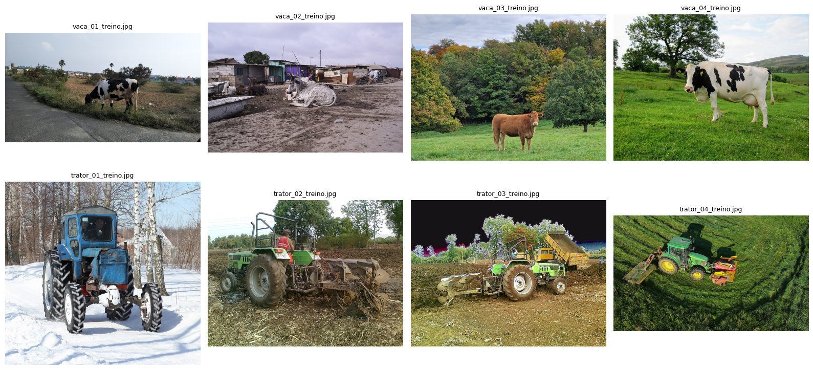
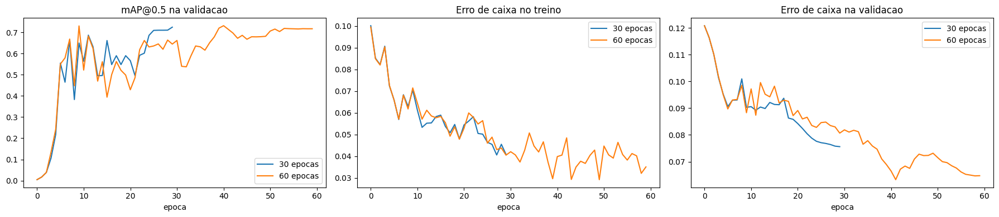
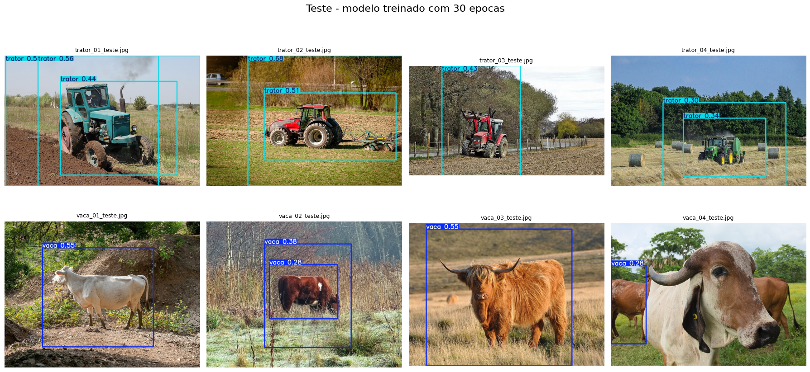
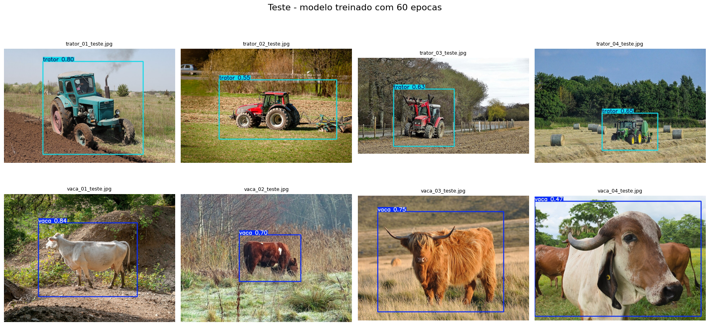
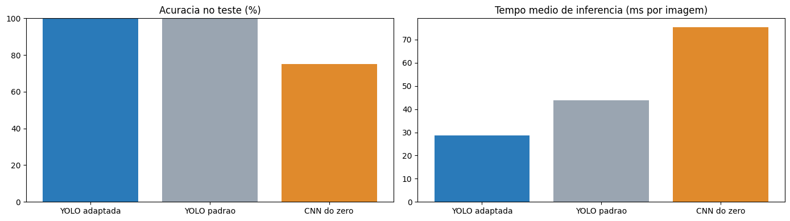
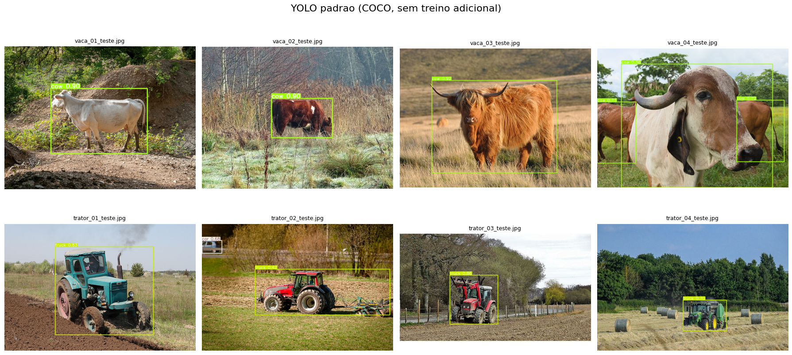
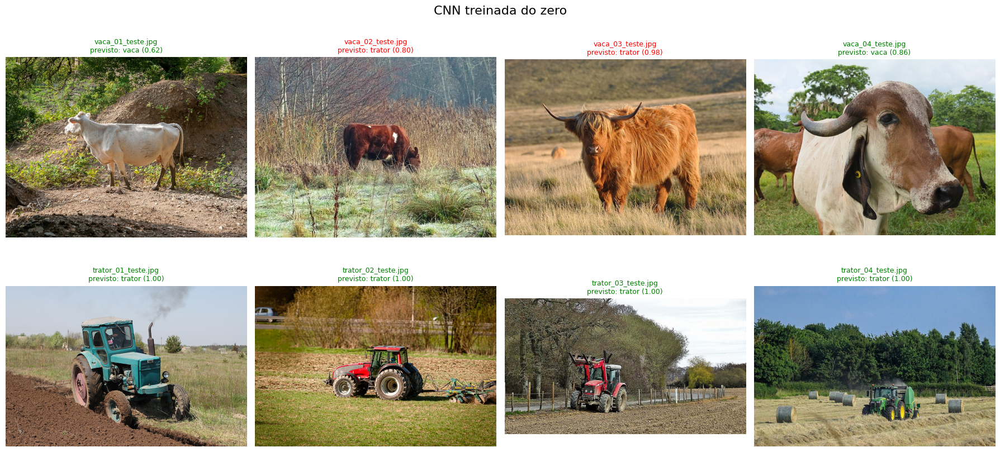

# FIAP - Faculdade de Informática e Administração Paulista

 

# Capítulo 1 - Fase 6: Visão Computacional com YOLO e CNN

## Integrantes:

- Caike Minhano - RM569255
- Renan Lucas Seni de Souza - RM570862

## Professores:

### Tutor(a)

- Sabrina Otoni

### Coordenador(a)

- André Godoi

## 📜 Descrição

A FarmTech Solutions expandiu seus serviços de IA para além do agronegócio e passou a atuar com visão computacional. Neste projeto, a equipe de desenvolvimento da FarmTech apresenta a um cliente um sistema de detecção de objetos construído com o **YOLOv5**, mostrando na prática como a tecnologia funciona e qual o nível de acurácia que pode ser alcançado.

O cenário escolhido usa dois objetos do ambiente rural, bem diferentes entre si: **vaca** e **trator**. A vaca é um ser vivo, com formas arredondadas e muita variação de cor e pelagem. O trator é uma máquina, com formato rígido, rodas grandes e cores fortes.

Toda a solução está documentada passo a passo no notebook do Google Colab:

### 📓 [Abrir o notebook no Google Colab](https://colab.research.google.com/drive/1JwUNS1_JBxDR104mPqeV2F1ZRh_vr5_t?usp=sharing)

Uma cópia do notebook executado também está em [`src/PBL_Fase6_Entrega1.ipynb`](src/PBL_Fase6_Entrega1.ipynb).

### 🎥 Vídeos de demonstração

Os links dos vídeos estão na seção [Vídeos de Demonstração](#-vídeos-de-demonstração-youtube---não-listados), no final deste README.

### Dataset

O dataset tem 80 imagens, obtidas no [Wikimedia Commons](https://commons.wikimedia.org/) somente com licenças livres (CC BY, CC BY-SA e domínio público).

As imagens, os rótulos e os resultados dos treinamentos também estão disponíveis na [pasta do projeto no Google Drive](https://drive.google.com/drive/folders/1_6Jir3apSEAUZD4BkAb1kbXDA6n9GOQP?usp=sharing).

| Etapa | Vaca | Trator | Total |
|---|---|---|---|
| Treino | 32 | 32 | 64 |
| Validação | 4 | 4 | 8 |
| Teste | 4 | 4 | 8 |

As imagens de treino e validação foram rotuladas manualmente no [Make Sense](https://www.makesense.ai/), com exportação no formato YOLO. Ao todo são 72 arquivos de rótulo, com 46 caixas de vaca e 36 de trator.

### Metodologia

1. Organização das imagens no Google Drive, separadas em treino, validação e teste
2. Rotulação das imagens de treino e validação no Make Sense
3. Montagem do dataset no formato do YOLOv5 dentro do Colab
4. Treinamento do modelo `yolov5s` (pré-treinado no COCO) em duas simulações: **30 épocas** e **60 épocas**
5. Validação com precisão, recall, mAP e erro (loss)
6. Teste nas 8 imagens que o modelo nunca viu

### Resultados resumidos

**Validação (melhores pesos de cada treino):**

| Métrica | 30 épocas | 60 épocas |
|---|---|---|
| Precisão | 0,712 | 0,790 |
| Recall | 0,786 | 0,768 |
| mAP@0.5 | 0,687 | 0,719 |
| mAP@0.5:0.95 | 0,405 | 0,503 |
| Tempo de treino (GPU T4) | 2,9 min | 4,1 min |
| Tempo de inferência por imagem | ~18 ms | ~18 ms |

**Teste:** nenhum dos dois modelos confundiu vaca com trator. O modelo de 30 épocas gerou caixas duplicadas ou muito grandes em parte das imagens e deixou de detectar a vaca principal em uma delas. O modelo de 60 épocas detectou corretamente o objeto principal em todas as 8 imagens, com caixas bem ajustadas e confiança entre 0,47 e 0,84.

O treino com 60 épocas custou cerca de 44% a mais de tempo, mas melhorou a precisão das caixas (mAP@0.5:0.95 de 0,405 para 0,503) e eliminou a maior parte dos falsos positivos. A principal limitação observada é a dificuldade com objetos pequenos ou distantes, como vacas ao fundo da imagem, além do tamanho reduzido do dataset. A análise completa está na seção de conclusões do notebook.

## 🔍 Entrega 2: comparação com outras abordagens

Na segunda entrega, a YOLO customizada da Entrega 1 foi comparada com duas abordagens "concorrentes", usando o mesmo dataset:

- **YOLO adaptada:** o modelo `yolov5s` treinado na Entrega 1 (60 épocas)
- **YOLO padrão:** o `yolov5s` original, pré-treinado no dataset COCO, sem nenhum treino adicional
- **CNN do zero:** uma rede convolucional simples, treinada apenas com as imagens do projeto, para classificar a imagem como vaca ou trator

### 📓 [Abrir o notebook da Entrega 2 no Google Colab](https://colab.research.google.com/drive/1BYZWHSyYCulxgXSSsVO7eRRnQEIAB75L?usp=sharing)

Uma cópia do notebook executado também está em [`src/PBL_Fase6_Entrega2.ipynb`](src/PBL_Fase6_Entrega2.ipynb).

### Resultados nas 8 imagens de teste

| Critério | YOLO adaptada | YOLO padrão (COCO) | CNN do zero |
|---|---|---|---|
| Acurácia no teste | 100% (8/8) | 100% (8/8)* | 75% (6/8) |
| Tempo de treino ou customização | 4,1 min + rotulação de 72 imagens | nenhum | 0,7 min |
| Inferência média (GPU T4) | 28,6 ms | 43,7 ms | 75,4 ms |
| Localiza o objeto na imagem? | sim | sim | não |
| Reconhece trator como classe própria? | sim | não | sim |

\* O COCO não tem a classe trator. Os tratores foram detectados como `truck` (caminhão) ou `car` (carro), e esses rótulos foram aceitos como trator na avaliação.

**Principais conclusões:**

- A **YOLO adaptada** foi a mais adequada ao cenário da FarmTech: é a única que reconhece trator como classe própria, localiza o objeto e acertou todas as imagens de teste. O principal custo é a rotulação manual, feita uma única vez.
- A **YOLO padrão** não precisa de nenhum treino e detecta muito bem as vacas, mas não sabe o que é um trator e o confunde com caminhão ou carro. Em uma fazenda com esses veículos, não seria possível diferenciá-los.
- A **CNN do zero** treina rápido, mas errou 2 das 4 vacas e se mostrou instável, com a acurácia de validação oscilando entre 62,5% e 100% de uma época para outra. Com apenas 64 imagens, aproveitar um modelo pré-treinado é muito mais eficiente do que treinar uma rede do zero.

A análise completa dos quatro critérios (facilidade de uso, precisão, tempo de treinamento e tempo de inferência) está na seção 8 do notebook da Entrega 2.

## 📁 Estrutura de pastas

Dentre os arquivos e pastas presentes na raiz do projeto, definem-se:

- **assets**: imagens usadas neste README (logo, amostras do dataset, gráficos e resultados dos testes das duas entregas).

- **document**: documentos do projeto. Na subpasta `other`, documentos complementares.

- **src**: código-fonte e dados da atividade.
  * `PBL_Fase6_Entrega1.ipynb` - notebook executado com todo o passo a passo da solução.
  * `PBL_Fase6_Entrega2.ipynb` - notebook executado com a comparação entre YOLO adaptada, YOLO padrão e CNN treinada do zero.
  * `data/imagens/` - as 80 imagens, separadas em `treino`, `validacao` e `teste`, cada uma com as subpastas `vaca` e `trator`.
  * `data/rotulos/` - os 72 arquivos de rótulo no formato YOLO, exportados do Make Sense.

- **README.md**: guia e explicação geral do projeto (este arquivo).

## 🔧 Como executar o código

### Pré-requisitos

- Conta Google, com acesso ao Google Drive e ao Google Colab
- Ambiente de execução com GPU no Colab (testado com Tesla T4)

### Passos

Os notebooks leem os dados da pasta `FIAP/FASE6_CAP1` no Google Drive de quem executa. Há duas formas de preparar essa pasta:

- **Opção A (mais rápida):** abrir a [pasta compartilhada do projeto](https://drive.google.com/drive/folders/1_6Jir3apSEAUZD4BkAb1kbXDA6n9GOQP?usp=sharing), clicar em *Organizar > Adicionar atalho* e criar o atalho dentro de uma pasta chamada `FIAP` no "Meu Drive". O caminho final deve ficar `Meu Drive/FIAP/FASE6_CAP1`. Nesse caso, a última célula do notebook da Entrega 1, que grava os resultados no Drive, precisa de permissão de edição e pode falhar, sem afetar o restante da execução.
- **Opção B:** criar a pasta `FIAP/FASE6_CAP1` no próprio Drive, copiar para ela as pastas `treino`, `validacao` e `teste` de `src/data/imagens/` e copiar os arquivos de `src/data/rotulos/` para `FIAP/FASE6_CAP1/rotulos`.

Em seguida:

1. Abrir o [notebook no Colab](https://colab.research.google.com/drive/1JwUNS1_JBxDR104mPqeV2F1ZRh_vr5_t?usp=sharing) e ativar a GPU em *Ambiente de execução > Alterar tipo de ambiente de execução*.
2. Executar todas as células em *Ambiente de execução > Executar tudo* e autorizar o acesso ao Google Drive quando solicitado.

O próprio notebook clona o repositório do [YOLOv5](https://github.com/ultralytics/yolov5) e instala as dependências. Os resultados ficam em `yolov5/runs/` e são copiados para `FIAP/FASE6_CAP1/resultados` no Drive.

O [notebook da Entrega 2](https://colab.research.google.com/drive/1BYZWHSyYCulxgXSSsVO7eRRnQEIAB75L?usp=sharing) usa os pesos do modelo treinado na Entrega 1 (`FIAP/FASE6_CAP1/resultados/train/treino_60ep/weights/best.pt`). Na opção A, esses pesos já estão na pasta compartilhada e o notebook pode ser executado diretamente. Na opção B, é preciso executar antes o notebook da Entrega 1. Os passos são os mesmos: abrir no Colab, ativar a GPU e executar todas as células.

## 🎥 Vídeos de Demonstração (YouTube - Não Listados)

<!-- PREENCHER: links dos vídeos no YouTube -->
- 🎬 [Vídeo 1 - Entrega 1](LINK_VIDEO_ENTREGA_1)
- 🎬 [Vídeo 2 - Entrega 2](LINK_VIDEO_ENTREGA_2)

## 🗃 Histórico de lançamentos

- 0.2.0 - 13/10/2026
  * Entrega 2: comparação entre YOLO adaptada, YOLO padrão (COCO) e CNN treinada do zero, avaliando facilidade de uso, precisão, tempo de treinamento e tempo de inferência.
- 0.1.0 - 13/10/2026
  * Entrega 1: dataset de vacas e tratores, rotulação no Make Sense, treinamento do YOLOv5 com 30 e 60 épocas, validação, teste e conclusões.

## 📋 Licença

<a property="dct:title" rel="cc:attributionURL" href="https://github.com/agodoi/template">MODELO GIT FIAP</a> por <a rel="cc:attributionURL dct:creator" property="cc:attributionName" href="https://fiap.com.br">Fiap</a> está licenciado sobre <a href="http://creativecommons.org/licenses/by/4.0/?ref=chooser-v1" target="_blank" rel="license noopener noreferrer" style="display:inline-block;">Attribution 4.0 International</a>.

